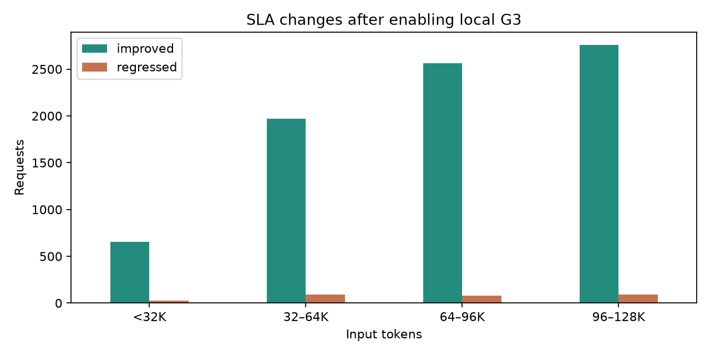

# P 本地 G3 全量回放分析

比较同一份 FreeInference 的 665,415 条请求。对照组仅 P 开 G2，实验组 P 开本地 G2 和 16,384 块本地 G3，两组 D 仅 HBM。逐行核对请求序号、到达时间、输入及输出长度，重算的 SLA 达标数与原生报告一致。SLA 要求完整输出、TTFT ≤ 5 秒、每请求平均 ITL ≤ 50 ms。

| SLA 变化 | 请求数 |
| --- | ---: |
| 不达标 → 达标 | 7,941 |
| 达标 → 不达标 | 292 |
| 两组均达标 | 628,073 |
| 两组均不达标 | 29,109 |
| 净增加达标 | 7,649 |

7,941 条改善请求中，原失败原因为 TTFT 的有 7,929 条，仅 ITL 的有 6 条，两项都超限的有 6 条。292 条退化请求中，291 条超 TTFT，1 条超 ITL。

| 输入长度 | 转达标 | 转不达标 | 净增加 |
| --- | ---: | ---: | ---: |
| <32K | 654 | 26 | 628 |
| 32–64K | 1,971 | 90 | 1,881 |
| 64–96K | 2,560 | 82 | 2,478 |
| 96–128K | 2,756 | 94 | 2,662 |

64K 及以上贡献了约 67% 的净新增达标。2,603 条改善请求首次准入时经 Host 层恢复的 token 更多，这个字段同时覆盖 DRAM 直接命中和 SSD 经 DRAM 读回。其他改善请求还可能受前序请求执行时间和排队变化影响，现有记录无法逐条归因。

按请求到达时间划分五分钟窗口，收益最大的是 8 月 26 日 14:55 UTC 起的 138 条请求，122 条转达标、0 条退化。退化最集中的窗口是 8 月 18 日 17:20 UTC 起的 87 条请求，7 条转达标、39 条退化。

| 变化 | 请求 | 到达时间（UTC） | 输入 token | TTFT（仅 G2 → 加 G3） |
| --- | --- | --- | ---: | --- |
| improved | request_547127 | 2026-08-26T14:55:26.002000+00:00 | 10,941 | 198.11 → 0.17 秒 |
| regressed | request_469061 | 2026-08-18T17:23:07.038000+00:00 | 88,343 | 4.57 → 153.10 秒 |

两组是已有的全量结果。仅 G2 使用单 P 接入的 cluster_shared，G3 组使用 dp_rank_local，G2 容量和该 rank 的链路上限相同。逐请求结果反映整轮缓存和排队时序变化。

- [逐请求翻转清单](assets/sla_flips.csv)
- [输入长度分组](assets/by_input_length.csv)
- [五分钟到达窗口](assets/by_arrival_5min.csv)
- [汇总及数据来源](assets/summary.json)

打开 analysis.ipynb 运行全部单元可重新生成产物。
