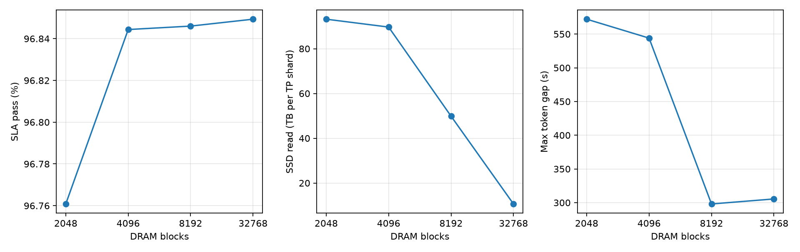

# P 侧 DRAM 容量扫描

四组均完成 665,415 条请求，SSD 固定 128×，读写各 10 GB/s。8192 块复用 SSD 128× 的结果。SSD 字节量按 TP 分片统计。

| DRAM 块数 | 达标数 | 相对基准 | P99 TTFT（秒） | SSD 读取（TB） | 最大 token 间隔（秒） |
| ---: | ---: | ---: | ---: | ---: | ---: |
| 2048 | 643861 | −567 | 14.43 | 93.19 | 572.11 |
| 4096 | 644417 | −11 | 13.78 | 89.67 | 544.06 |
| 8192 | 644428 | 基准 | 13.82 | 49.86 | 298.06 |
| 32768 | 644450 | +22 | 13.83 | 10.64 | 305.50 |

4096 块的达标率与基准接近，但累计 SSD 读取增加约 80%，最大间隔明显变长。2048 块额外出现 7 次恢复回退。32768 块将读取减少约 79%，达标数仅多 22。SSD 累计写入仍约 139.61–139.76 TB。

最大单次间隔独立于 SLA 的每请求平均 ITL。现有结果无法定位长停顿的直接原因。下一轮固定 SSD 写带宽，比较 4096 和 8192 块下的 2.5 与 5 GB/s 读带宽。暂按各自 10 GB/s 对照的达标率最多下降 0.10 个百分点判定，分别最多减少 665 条达标请求，同时单列尾部指标。

[汇总 CSV](assets/metrics.csv) · [带原始报告路径的 JSON](assets/summary.json) · [Notebook](analysis.ipynb)
