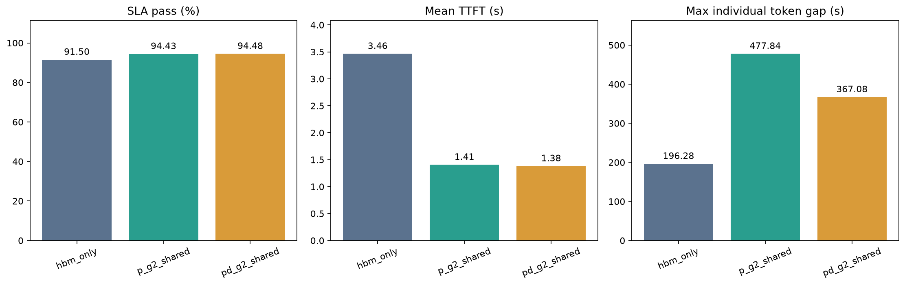
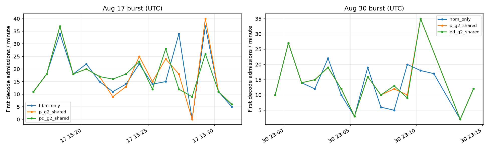
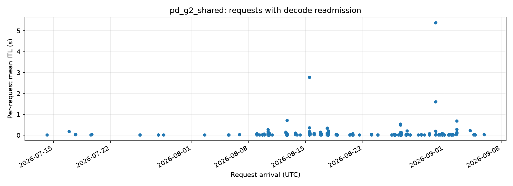

# P/D 共用 G2 池

目的：在相同池容量及带宽下，考察D接入同一个G2池的增量效果；P→D仍直接交接。

配置：`../../configs/pd_g2_shared.yaml`。单组脚本：`../../scripts/run_experiment.py`；G2两组也可用 `run_g2_experiments.py` 顺序运行。

## 结果总览

| 指标 | 本实验结果 |
| --- | ---: |
| 完成请求数 | 665,415 |
| SLA达标率（%） | 94.48 |
| 平均TTFT（秒） | 1.38 |
| P99 TTFT（秒） | 19.25 |
| 平均ITL（毫秒） | 13.00 |
| 最大单次token间隔（秒） | 367.08 |

数据：[本组指标](assets/metrics.csv) · [汇总与来源](assets/summary.json) · [三组对照表](assets/comparison.csv)

## 当前结果

全量628,709条达标（94.48%），较仅P开G2多344条；平均TTFT为1.38秒，P99为19.25秒。最大单次token间隔367.08秒，额外平均收益较小，仍存在极端停顿。

以上为2026-11-05已完成的同一全量负载，具体来源见 `assets/summary.json`。后续重跑后请核对并更新本说明。

## 分析复现

打开唯一的 `analysis.ipynb` 并运行全部单元，可更新汇总表和对比图；设置 `RUN_DIR` 可指定历史运行。`assets/summary.json` 保存结果与来源，`assets/metrics.csv` 保存本组指标，`assets/comparison.csv/json` 和 `assets/comparison.png` 保存已有三组汇总的对比。

前缀复用比例不是DRAM命中率。最大token间隔不是SLA使用的平均ITL；当前还不能将长停顿归因于某个缓存机制，也不能推导SSD带宽需求。

## 新增：G2 后最大 token 间隔变长的诊断

### 已确认的现象

| 配置 | 重新准入请求数 | 每请求平均 ITL 超过50ms的请求数 |
| --- | ---: | ---: |
| HBM-only | 205 | 46 |
| 仅 P 开 G2 | 192 | 57 |
| P/D 共享 G2 | 189 | 54 |

G2 并未增加重新准入请求总数，但少数请求的等待显著加重。异常主要出现在长输入、连续到达且只有一个 TP8 Decode 实例的时段。最大值也来自不同时间的请求，不能把三个最大值当作同一请求的直接对照。

### 候选事件与时间（UTC）

- HBM-only：`request_415432` 是主要重新准入候选。8月12日16:43:37.547产生首token，16:46:58.749重新准入D；输入75,504、输出1,422。全局最大间隔196.28秒，但这不是由逐token证据精确定位的事件。
- 仅P开G2：`request_457534` 是唯一同时满足“生成总时长不小于477.84秒”且发生重新准入的候选。8月17日15:21:27.012产生首token，15:29:28.493重新准入D；输入112,094、输出830，重新准入复用输入token数为0。整个首token至重新准入时段481.48秒，是候选时段，不是精确停顿区间。
- P/D共池：`request_595423` 是唯一满足相应必要条件且发生重新准入的候选。8月30日23:04:25.531产生首token，23:10:33.648重新准入D；输入95,684、输出233，重新准入复用95,680个输入token。对应候选时段368.12秒，全局最大间隔367.08秒。

不发生重新准入的正常长输出请求也可能满足“生成总时长足够长”，所以这些仍是强候选，而非精确最大间隔归属证明。`request_N` 是转换后trace的请求序号，不是源agent会话ID。时间由首条源请求UTC和原生相对时钟对齐，不能直接把仿真毫秒加到5月17日零点。

### 同一请求的对照

| 请求 | HBM-only平均ITL / 重新准入次数 | 仅P开G2 | P/D共池 |
| --- | --- | --- | --- |
| `request_457534` | 16.79 ms / 0 | 595.37 ms / 1 | 342.83 ms / 1 |
| `request_595423` | 19.25 ms / 0 | 1598.24 ms / 1 | 1600.55 ms / 1 |
| `request_595428` | 20.01 ms / 0 | 5381.54 ms / 1 | 5391.85 ms / 1 |

同一请求开G2后反而更早开始生成：457534的TTFT由32.67秒降为约23.85秒；595423由31.22秒降为约24.06秒。但之后均出现D侧重新准入，导致生成阶段变长。对应请求首次P准入的Host复用均为0，因此不能简单解释成这些请求自己命中DRAM后搬运了几百秒；更可能是其他请求缓存收益改变了整个D侧到达和竞争顺序。

### 发生时的负载与机制

[同一请求对照表](assets/stall_comparison.csv) · [分钟级负载](assets/stall_load_minutes.csv)

- 8月17日15:21:19.236起的一分钟有21个请求，其中15个输入至少64K，输入合计约169万token。D侧首次准入数由基线15个变为G2两组17个。
- 8月30日23:04:19.236起的一分钟有24个请求，其中20个输入至少64K，输入合计约219万token；下一分钟26个请求全部至少64K。前一分钟D首次准入由基线10个变为G2两组12个。
- 当前D侧KV容量约38.7万token；长上下文并发会增加G1容量压力。但输入token总和不等于实际HBM占用，因为还有共享前缀和执行时序。
- 代码证据：`crates/core/src/engine/scheduler/vllm/core.rs` 的 `policy_preempt` 用于KV分配/Decode预留失败时抢占运行请求，释放其KV；重新准入后继续或重算。当前报告确实记录了D重新准入，与该容量压力路径一致。

**当前解释（推断）**：G2改变P处理和交接时序，使部分长请求在D侧发生不同的HBM竞争、抢占和恢复排队。整体首token时延改善，不保证每个请求的生成尾延迟也改善。现有证据支持“D侧中断/恢复相关”，不能进一步证明具体哪个请求触发抢占，也不能区分排队、重算与锁定缓存各自贡献。

### 证据边界与后续验证

[诊断证据](assets/stall_analysis.json) · [候选请求](assets/stall_candidates.csv)

原始报告没有逐token时间戳，`pressure_record_ordinals` 为空，也没有采集对应时刻的队列/G1/G2占用。因此无法精确恢复最大间隔起止或断言发生了仿真bug。全局最大ITL是单次间隔，逐请求JSONL的 `itl_ms` 是平均值，分析不能将两者混用。

下一步若要定案，应保持前序缓存和排队历史，增加有界的目标请求token事件以及抢占/容量日志，再回放候选时段；不能只截取该分钟冷启动来声称严格复现。当前未修改内核，也未启动新的全量仿真。

复现入口：本目录 `analysis.ipynb` 的长停顿单元。新增 `assets/stall_analysis.json`、`assets/stall_readmissions.json`、`assets/stall_candidates.csv/json`、`assets/stall_matched_requests.csv`、`assets/stall_load_minutes.csv` 和诊断图保存上述证据。

## 文件布局

本层只保存 `README.md` 和 `analysis.ipynb`；数据、缓存和图片均位于 `assets/`。Notebook 再次运行也会写入该目录。上述图和表由 Notebook 生成，更新数据后需复核手写结论及本页数值。
