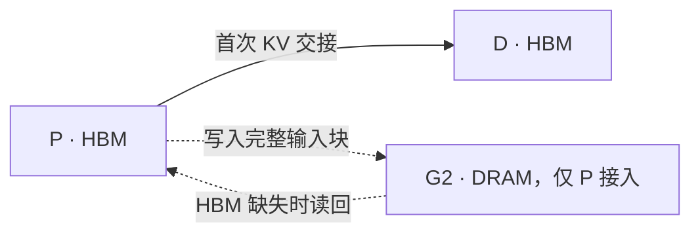
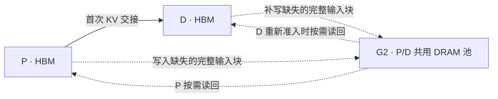
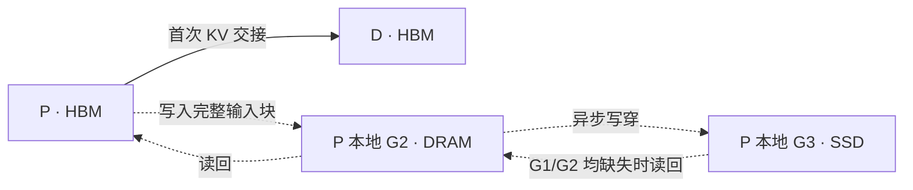

# 1P1D 的三种 KV 缓存配置

三个实验均为 GLM-5.2-FP8、H200、每个实例 TP8。G1 是各实例的 HBM，G2 是 Host DRAM，G3 是 SSD。下图实线表示首次 P→D 交接，虚线表示各层缓存的读写。

| 实验 | P 侧缓存 | D 侧缓存 | 实现来源 |
| --- | --- | --- | --- |
| [仅 P 开共享 G2](configs/p_g2_shared.yaml) | HBM + G2 | HBM | 官方 AISimulate |
| [P/D 共用 G2](configs/pd_g2_shared.yaml) | HBM + G2 | HBM + 同一个 G2 池 | 官方 AISimulate |
| [P 本地 G2 + G3](configs/p_g3_local.yaml) | HBM + 本地 G2 + 本地 G3 | HBM | 本项目将官方混部 G3 路径接入 P 角色 |

## 1. 官方：仅 P 开共享 G2

P 算出完整的输入前缀块后，会尝试把池中缺失的块复制到 G2。后续请求先复用 P 的 HBM，再从 G2 恢复仍然缺失的前缀，其余部分重算。配置为 `cluster_shared`，但在这组 1P1D 中只有一个 P 接入，所以该池由 P 独用，D 不访问它。

## 2. 官方：P/D 共用 G2

P、D 都设为 `cluster_shared`，共用 **8192 块**总容量。首次交接完成后，D 调度到该请求时，可以把 D 的 HBM 中已就绪、池中缺失的完整输入块复制到 G2。例如 P 此前没写成功，或者对应块已经从共享池被淘汰，D 就可能补写。已存在或正在写入的块会跳过。

D 被抢占后重新准入时，可以从共享池读回输入前缀，包括 P 写入的块。当前连接器 `offloading_v0_24` 只处理完整输入前缀块，D 新生成的输出 KV 不写入 G2。共享池是仿真中的逻辑资源，跨节点访问没有单独的网络拓扑模型。

## 3. 本项目：P 本地 G2 + G3

P 的 G2 使用 `dp_rank_local`，G3 使用 `worker_local`。G2 完成写入后，符合条件的块会在后台写入 G3，无须等 G2 淘汰。后续请求若在 G1/G2 均未找到所需前缀，但 G3 仍有副本，则走 **SSD → DRAM → HBM**。D 保持仅 HBM。这组的本地池归 P 所有。

功能验证使用 A → B → A。B 挤出 A 在 G1/G2 的前缀后，第二次 A 在仅 G2 对照中复用 0 token，在 G3 组经 SSD 恢复并复用 128 token。[验证脚本](scripts/validate_p_g3_local.py)

## 容量、淘汰与交接口径

- 三组 G2 容量均为 8192 块，KV 块大小均为 64 token。G3 全量基准为 16,384 块。
- G2 按 LRU 从可回收块里腾空间。正在写入、被读回操作锁定的块会跳过。如果无法为整批写入腾出空间，连接器会暂缓这次写入。
- 三组首次 P→D 交接都走 **P 的 HBM → D 的 HBM**。交接配置为 `destination_missing`，只对 D 的 HBM 缺失部分计传输时间，带宽设为 50 GB/s。DRAM 和 SSD 的缓存搬运单独计时。

更多参数和运行方式见 [实验索引](experiments.md)。
