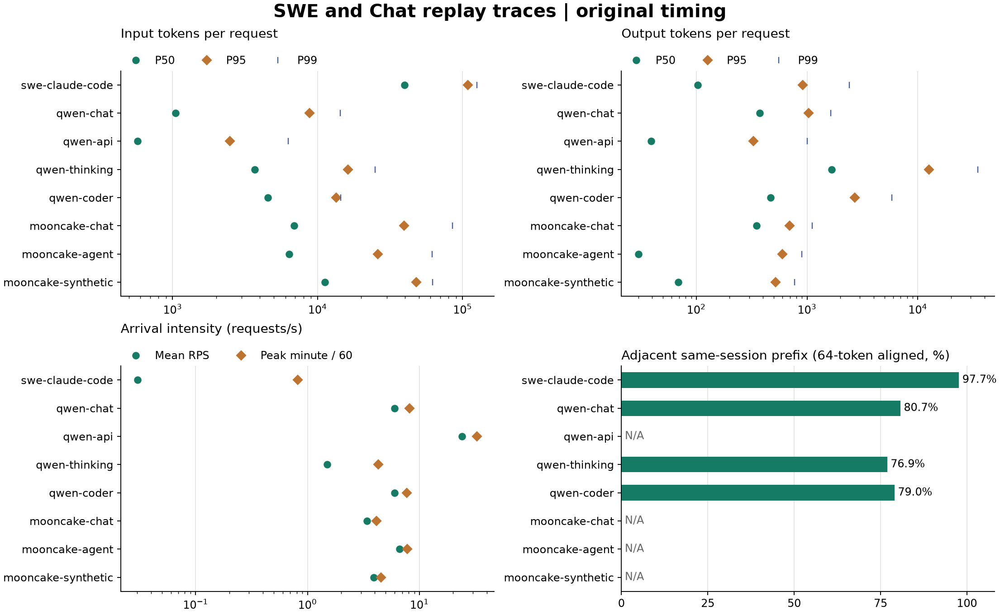

# SWE-chat 与 Qwen、Mooncake 负载特征对比

统计时间 2026-11-23T15:59:48+08:00。数据来自 AISim 使用的原速回放包。SWE 采用 verified-interleave 版 Claude Code 主会话，Chat 采用现有 7 个独立数据包。所有时间轴保持 1×。

## 主要差异

- **SWE 的输入长、输出相对短。** SWE 输入 P50 为 39,659 token，是 Qwen Chat（1,046）的 37.9 倍。SWE 输出 P50 为 103，Qwen Chat 为 376。Mooncake Chat 的输入 P50 已达 6,909，因此短输入并非这些 Chat trace 的共同特征。

- **SWE 原速负载更稀疏，但单次输入更重。** SWE 覆盖约 231.79 天，平均 0.030 请求/秒。真实 Chat trace 的观察窗约 1–2 小时，Qwen Chat 和 Mooncake Chat 平均分别为 5.98、3.40 请求/秒。比较 prefill 压力时，应同时看输入 token/s 和峰值，不能只比较请求数。

- **SWE 的同会话请求更多，前缀也更稳定。** SWE 每会话请求数 P50 / P95 为 37 / 170，Qwen Chat 为 1 / 5。按 64-token 块对齐，在同会话相邻请求中，匹配前缀占后续请求输入 token 的 97.67%（SWE）和 80.73%（Qwen Chat）。这衡量的是输入序列相似度与潜在复用量，实际命中还取决于缓存驻留、调度和跨会话共享。

- **请求率与 token 负载的排序不同。** Qwen API 平均约 24 请求/秒，在所测 trace 中最高。Mooncake Agent 约 6.68 请求/秒，但平均输入约 57,376 token/秒，约为 Qwen API 的 2.6 倍。Qwen Thinking 平均仅 1.50 请求/秒，输出 P99 却达到 34,687 token，适合单独观察 decode 长尾。

- **Mooncake 两份真实 trace 在记录层面集中到达。** Mooncake Chat 与 Agent 的相邻请求中，分别有 90.20% 和 95.01% 时间戳相同，两者均只有约三分之一的秒桶出现请求。原速回放会保留这批同时间戳到达。



## 请求规模与到达节奏

| 数据集 | 请求数 | 会话数 | 首尾跨度 | 平均 RPS | P95 / 峰值请求/分钟 | 有请求的秒桶 | 相邻同时间戳 |
| --- | --- | --- | --- | --- | --- | --- | --- |
| swe-claude-code | 607,190 | 10,962 | 231.79 天 | 0.030 | 9 / 49 | 2.92% | 0.98% |
| qwen-chat | 43,058 | 23,101 | 119.99 分钟 | 5.981 | 474 / 488 | 99.49% | 0.32% |
| qwen-api | 172,800 | 172,800 | 120.00 分钟 | 24.000 | 1,868 / 1,961 | 100.00% | 1.29% |
| qwen-thinking | 10,812 | 9,612 | 119.86 分钟 | 1.503 | 199 / 258 | 69.49% | 0.40% |
| qwen-coder | 43,011 | 26,406 | 119.98 分钟 | 5.975 | 421 / 461 | 99.67% | 0.30% |
| mooncake-chat | 12,031 | — | 58.95 分钟 | 3.401 | 238 / 247 | 33.36% | 90.20% |
| mooncake-agent | 23,608 | — | 58.95 分钟 | 6.675 | 456 / 469 | 33.36% | 95.01% |
| mooncake-synthetic | 3,983 | — | 17.03 分钟 | 3.897 | 261 / 272 | 97.07% | 0.28% |

平均 RPS 用请求数除以首末记录跨度。峰值与 P95 使用从相对时间零点开始的固定 60 秒桶，P95 包含空桶。相邻同时间戳的比例反映记录里的到达批次和时间粒度，不能单独用来判断真实网络并发。

## Token 长度与负载结构

| 数据集 | 输入 P50 / P95 / P99 | 输出 P50 / P95 / P99 | 输入+输出 >32K | 输入+输出 >64K | 平均输入 token/s | 平均输出 token/s |
| --- | --- | --- | --- | --- | --- | --- |
| swe-claude-code | 39,659 / 108,498 / 125,634 | 103 / 910 / 2,410 | 57.99% | 26.88% | 1,381.7 | 7.7 |
| qwen-chat | 1,046 / 8,808 / 14,365 | 376 / 1,032 / 1,641 | 0.04% | 0.02% | 13,943.1 | 2,574.5 |
| qwen-api | 574 / 2,491 / 6,294 | 39 / 328 / 1,006 | 0.01% | 0.00% | 21,948.6 | 2,199.1 |
| qwen-thinking | 3,680 / 16,221 / 24,973 | 1,666 / 12,670 / 34,687 | 1.45% | 0.05% | 7,160.5 | 5,488.5 |
| qwen-coder | 4,540 / 13,406 / 14,407 | 469 / 2,699 / 5,842 | 0.03% | 0.00% | 34,340.4 | 4,829.1 |
| mooncake-chat | 6,909 / 39,550 / 85,400 | 350 / 698 / 1,119 | 7.03% | 2.14% | 40,936.9 | 1,165.4 |
| mooncake-agent | 6,346 / 26,110 / 61,661 | 30 / 600 / 898 | 3.15% | 0.91% | 57,376.3 | 1,215.7 |
| mooncake-synthetic | 11,268 / 47,829 / 62,056 | 69 / 519 / 768 | 15.97% | 0.93% | 58,058.8 | 582.1 |

Token/s 按整段观察窗计算，是输入和计划输出的负载速率。SWE 按 GLM-5.2 tokenizer 重建，Chat 采用各上游的 token 数。比值适合比较模拟负载形状，不能解释为相同 tokenizer 的文本长度比。

## 会话深度与可观测前缀

| 数据集 | 请求/会话 P50 / P95 / 最大 | 仅一请求的会话 | 同会话相邻对 | 间隔 P50 / P95（秒） | 前缀占比 16 / 64 token 块 | ≥90% 前缀的相邻对 | 64 块匹配量 / 全部输入 |
| --- | --- | --- | --- | --- | --- | --- | --- |
| swe-claude-code | 37 / 170 / 658 | 2.03% | 596,228 | 8.53 / 183.14 | 97.72% / 97.67% | 88.00% | 97.64% |
| qwen-chat | 1 / 5 / 37 | 60.99% | 19,957 | 110.64 / 1,151.94 | 81.48% / 80.73% | 20.05% | 48.46% |
| qwen-api | 1 / 1 / 1 | 100.00% | 0 | — | — | — | 0.00% |
| qwen-thinking | 1 / 2 / 16 | 94.70% | 1,200 | 28.57 / 449.47 | 77.20% / 76.92% | 39.92% | 15.02% |
| qwen-coder | 1 / 4 / 54 | 74.65% | 16,605 | 117.72 / 1,609.09 | 79.44% / 79.03% | 25.96% | 31.10% |
| mooncake-chat | — | — | — | — | — | — | — |
| mooncake-agent | — | — | — | — | — | — | — |
| mooncake-synthetic | — | — | — | — | — | — | — |

同会话配对取时间排序中上一条保留记录。Qwen 分支和 SWE 被过滤调用可能使这对记录跨过原始轮次，因此表里的间隔是调用记录间隔，不能直接当成用户思考时间。前缀从两个输入的第一个 hash 块开始连续匹配，只计完整块，64-token 列把连续匹配长度向下对齐。配对占比按后续输入 token 加权，最后一列把首条请求也放进分母。Qwen API 全是单轮，已知的会话内相邻匹配量为 0。Mooncake 没有显式 session ID，这几列留空，其 512-token 源 hash 仍可用于独立的前缀缓存分析。

## 用于实验解读的对照

- **普通交互对照**用 Qwen Chat 和 Mooncake Chat。前者可核查会话深度与间隔，后者可补充长输入的普通对话流量。Qwen Chat 按源记录保留各请求类型，实际构成为 text 31,744、search 8,187、image 1,617、file 1,510。

- **子场景对照**可单列 Qwen API、Thinking、Coder 与 Mooncake Agent。API 用来观察高请求密度和单轮请求，Thinking 用来看输出长度尾部，Coder 与 Agent 可用来观察代码及工具类负载。Mooncake Synthetic 的到达时间由 Poisson 过程生成，单列为合成对照。

- **解读 DRAM/SSD 扫描**时，对照输入速率、前缀字节规模和会话内间隔。SWE 的原速数据更适合作为负载形状对照，既有 SWE 叠加扫描的请求密度应按实际叠加配置另行比较。

## 数据来源与复现

- SWE 原速记录的首尾响应事件为 `2026-01-15T20:30:19.799Z` 和 `2026-09-04T15:27:18.769Z`（UTC）。使用首个响应事件作为到达时间代理。请求来自 Claude Code 主会话的可重建调用，超过 128K 的调用已过滤，系统提示词和工具 schema 未计入重建历史。

- Qwen 四个包的时间戳是源 trace 的相对到达时间。Mooncake Chat 与 Agent 同样使用源请求到达时间。Synthetic 保留的 3,983 条请求包含原始合成时间轴，其中 10 条超限的源请求已过滤。

- 统计程序逐行核对 `requests.jsonl` 与 `source_requests.jsonl` 的索引和时间戳，长度分位数取线性插值。完整输入路径、未四舍五入的指标和分组数值见 `analysis/trace_comparison/metrics.json`。

```bash
cd /home/xieqiang/project/aisimulate
~/.venvs/aisim/bin/python experiments/disk_chat/scripts/compare_workload_traces.py \
  --output experiments/disk_chat/analysis/trace_comparison
```
