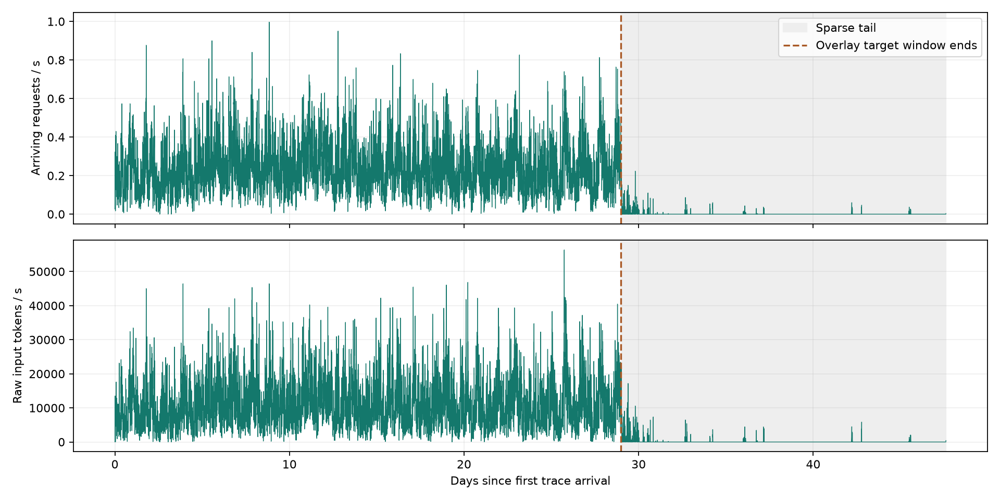
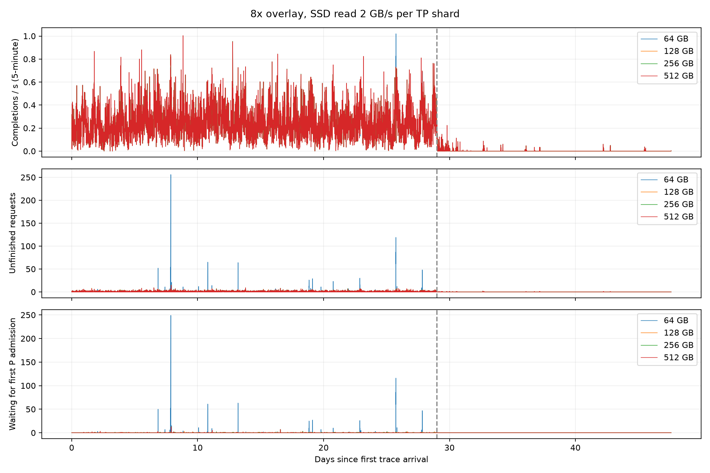

# 8× 叠加：需求、完成吞吐与积压分析

交互展示：[GLM 吞吐与等待 HTML](../../throughput_glm52.html)，可选择单个配置、查看五分钟曲线并导出数据。

## 1. 目的与统计窗口

先用已有场景 1 结果确认到达需求、实际完成和积压情况，为后续容量测试选择配置。本次没有新增仿真实验，也没有改动原有结果文档。

输入共 **607,190 条请求**；已纳入 **30 组完成的 8× 配置**。主要负载时段由数据包的 `overlay.segment_ms` 确定，所有配置共用，不按仿真结果或时间前 50% 划分。

| 窗口 | 时间范围（天） | 请求数 | 占全部请求 | 平均请求/s | 输入 token/s | 预期输出 token/s |
|---|---:|---:|---:|---:|---:|---:|
| 主要负载时段 | 0.00–28.97 | 603,973 | 99.470% | 0.2413 | 10,960.2 | 61.1 |
| 全到达时段 | 0.00–47.60 | 607,190 | 100.000% | 0.1476 | 6,728.1 | 37.4 |
| 稀疏尾段 | 28.97–47.60 | 3,217 | 0.530% | 0.0020 | 145.5 | 0.5 |

高峰用固定 5 分钟分桶统计。只使用完整落入窗口的桶，零到达桶也参与 P95；分桶起点固定为首次到达。

| 主要负载时段的需求 | 平均 | 5 分钟速率 P95 | 5 分钟速率最大值 |
|---|---:|---:|---:|
| 请求/s | 0.241 | 0.477 | 0.997 |
| 输入 token/s | 10,960.208 | 24,428.021 | 56,343.230 |
| 预期输出 token/s | 61.094 | 125.471 | 460.093 |

## 2. 三个时段的到达需求与实际完成吞吐

以下三表均覆盖同一批 30 组配置，使用相同输入确定时间窗口。完成请求按 terminal_time_ms 计入；输出吞吐按窗口内完成请求的全部输出 token 归属统计，不是逐 token 实际生成速率。全部时段截止于最后一次到达，之后的排空耗时见第 3 节。

到达输入 token/s 为窗口内到达请求的完整输入 token 总量除以窗口时长，包含可复用前缀，不等于 P 实际计算 token/s。现有结果不能恢复分时段的实际计算速率，整场实际计算量见第 3 节。

未完成请求覆盖 P、交接与 D；其数量不能直接当成 P 的计算队列。高峰表给出窗口初末积压；主要负载与全部时段额外列出逐请求事件计算的精确峰值积压。

### 2.1 高峰时段

固定输入 token 总量最高的同一个 5 分钟：第 25.73958–25.74306 天。该窗口到达 222 条请求，16,902,969 个输入 token，预期输出 42,331 个 token。最高输入量窗口与最高请求数窗口不一定相同，此处各配置使用同一个窗口。

| P DRAM（GB） | SSD 读（GB/s/TP） | 到达请求/s | 完成请求/s | 到达输入 token/s | 预期输出 token/s | 完成归属输出 token/s | 窗口初积压 | 窗口末积压 |
|---:|---:|---:|---:|---:|---:|---:|---:|---:|
| 64 | 1 | 0.7400 | 0.8567 | 56,343.23 | 141.10 | 145.79 | 72 | 37 |
| 64 | 2 | 0.7400 | 0.8267 | 56,343.23 | 141.10 | 139.21 | 87 | 61 |
| 64 | 4 | 0.7400 | 0.8100 | 56,343.23 | 141.10 | 137.43 | 71 | 50 |
| 64 | 8 | 0.7400 | 0.6833 | 56,343.23 | 141.10 | 121.99 | 2 | 19 |
| 64 | 16 | 0.7400 | 0.6633 | 56,343.23 | 141.10 | 116.38 | 2 | 25 |
| 128 | 1 | 0.7400 | 0.7267 | 56,343.23 | 141.10 | 135.68 | 3 | 7 |
| 128 | 2 | 0.7400 | 0.7267 | 56,343.23 | 141.10 | 132.90 | 2 | 6 |
| 128 | 4 | 0.7400 | 0.7300 | 56,343.23 | 141.10 | 134.39 | 2 | 5 |
| 128 | 8 | 0.7400 | 0.7300 | 56,343.23 | 141.10 | 134.39 | 2 | 5 |
| 128 | 16 | 0.7400 | 0.7300 | 56,343.23 | 141.10 | 134.39 | 2 | 5 |
| 256 | 1 | 0.7400 | 0.7233 | 56,343.23 | 141.10 | 131.75 | 2 | 7 |
| 256 | 2 | 0.7400 | 0.7267 | 56,343.23 | 141.10 | 132.90 | 2 | 6 |
| 256 | 4 | 0.7400 | 0.7300 | 56,343.23 | 141.10 | 134.39 | 2 | 5 |
| 256 | 8 | 0.7400 | 0.7300 | 56,343.23 | 141.10 | 134.39 | 2 | 5 |
| 256 | 16 | 0.7400 | 0.7300 | 56,343.23 | 141.10 | 134.39 | 2 | 5 |
| 384 | 1 | 0.7400 | 0.7267 | 56,343.23 | 141.10 | 132.90 | 2 | 6 |
| 384 | 2 | 0.7400 | 0.7267 | 56,343.23 | 141.10 | 132.90 | 2 | 6 |
| 384 | 4 | 0.7400 | 0.7300 | 56,343.23 | 141.10 | 134.39 | 2 | 5 |
| 384 | 8 | 0.7400 | 0.7300 | 56,343.23 | 141.10 | 134.39 | 2 | 5 |
| 384 | 16 | 0.7400 | 0.7300 | 56,343.23 | 141.10 | 134.39 | 2 | 5 |
| 512 | 1 | 0.7400 | 0.7300 | 56,343.23 | 141.10 | 134.39 | 2 | 5 |
| 512 | 2 | 0.7400 | 0.7300 | 56,343.23 | 141.10 | 134.39 | 2 | 5 |
| 512 | 4 | 0.7400 | 0.7300 | 56,343.23 | 141.10 | 134.39 | 2 | 5 |
| 512 | 8 | 0.7400 | 0.7300 | 56,343.23 | 141.10 | 134.39 | 2 | 5 |
| 512 | 16 | 0.7400 | 0.7300 | 56,343.23 | 141.10 | 134.39 | 2 | 5 |
| 1000 | 1 | 0.7400 | 0.7300 | 56,343.23 | 141.10 | 134.39 | 2 | 5 |
| 1000 | 2 | 0.7400 | 0.7300 | 56,343.23 | 141.10 | 134.39 | 2 | 5 |
| 1000 | 4 | 0.7400 | 0.7300 | 56,343.23 | 141.10 | 134.39 | 2 | 5 |
| 1000 | 8 | 0.7400 | 0.7300 | 56,343.23 | 141.10 | 134.39 | 2 | 5 |
| 1000 | 16 | 0.7400 | 0.7300 | 56,343.23 | 141.10 | 134.39 | 2 | 5 |

### 2.2 主要负载时段

前 28.97370 天，共 603,973 条到达请求，占全部请求 99.470%。

| P DRAM（GB） | SSD 读（GB/s/TP） | 到达请求/s | 完成请求/s | 到达输入 token/s | 预期输出 token/s | 完成归属输出 token/s | 窗口初积压 | 窗口末积压 | 峰值积压 |
|---:|---:|---:|---:|---:|---:|---:|---:|---:|---:|
| 64 | 1 | 0.2413 | 0.2413 | 10,960.21 | 61.09 | 61.09 | 0 | 3 | 259 |
| 64 | 2 | 0.2413 | 0.2413 | 10,960.21 | 61.09 | 61.09 | 0 | 3 | 314 |
| 64 | 4 | 0.2413 | 0.2413 | 10,960.21 | 61.09 | 61.09 | 0 | 3 | 97 |
| 64 | 8 | 0.2413 | 0.2413 | 10,960.21 | 61.09 | 61.09 | 0 | 3 | 180 |
| 64 | 16 | 0.2413 | 0.2413 | 10,960.21 | 61.09 | 61.09 | 0 | 3 | 142 |
| 128 | 1 | 0.2413 | 0.2413 | 10,960.21 | 61.09 | 61.09 | 0 | 3 | 78 |
| 128 | 2 | 0.2413 | 0.2413 | 10,960.21 | 61.09 | 61.09 | 0 | 3 | 68 |
| 128 | 4 | 0.2413 | 0.2413 | 10,960.21 | 61.09 | 61.09 | 0 | 3 | 21 |
| 128 | 8 | 0.2413 | 0.2413 | 10,960.21 | 61.09 | 61.09 | 0 | 3 | 19 |
| 128 | 16 | 0.2413 | 0.2413 | 10,960.21 | 61.09 | 61.09 | 0 | 3 | 27 |
| 256 | 1 | 0.2413 | 0.2413 | 10,960.21 | 61.09 | 61.09 | 0 | 3 | 20 |
| 256 | 2 | 0.2413 | 0.2413 | 10,960.21 | 61.09 | 61.09 | 0 | 3 | 19 |
| 256 | 4 | 0.2413 | 0.2413 | 10,960.21 | 61.09 | 61.09 | 0 | 3 | 19 |
| 256 | 8 | 0.2413 | 0.2413 | 10,960.21 | 61.09 | 61.09 | 0 | 3 | 19 |
| 256 | 16 | 0.2413 | 0.2413 | 10,960.21 | 61.09 | 61.09 | 0 | 3 | 27 |
| 384 | 1 | 0.2413 | 0.2413 | 10,960.21 | 61.09 | 61.09 | 0 | 3 | 19 |
| 384 | 2 | 0.2413 | 0.2413 | 10,960.21 | 61.09 | 61.09 | 0 | 3 | 19 |
| 384 | 4 | 0.2413 | 0.2413 | 10,960.21 | 61.09 | 61.09 | 0 | 3 | 19 |
| 384 | 8 | 0.2413 | 0.2413 | 10,960.21 | 61.09 | 61.09 | 0 | 3 | 19 |
| 384 | 16 | 0.2413 | 0.2413 | 10,960.21 | 61.09 | 61.09 | 0 | 3 | 27 |
| 512 | 1 | 0.2413 | 0.2413 | 10,960.21 | 61.09 | 61.09 | 0 | 3 | 19 |
| 512 | 2 | 0.2413 | 0.2413 | 10,960.21 | 61.09 | 61.09 | 0 | 3 | 19 |
| 512 | 4 | 0.2413 | 0.2413 | 10,960.21 | 61.09 | 61.09 | 0 | 3 | 19 |
| 512 | 8 | 0.2413 | 0.2413 | 10,960.21 | 61.09 | 61.09 | 0 | 3 | 19 |
| 512 | 16 | 0.2413 | 0.2413 | 10,960.21 | 61.09 | 61.09 | 0 | 3 | 27 |
| 1000 | 1 | 0.2413 | 0.2413 | 10,960.21 | 61.09 | 61.09 | 0 | 3 | 19 |
| 1000 | 2 | 0.2413 | 0.2413 | 10,960.21 | 61.09 | 61.09 | 0 | 3 | 19 |
| 1000 | 4 | 0.2413 | 0.2413 | 10,960.21 | 61.09 | 61.09 | 0 | 3 | 19 |
| 1000 | 8 | 0.2413 | 0.2413 | 10,960.21 | 61.09 | 61.09 | 0 | 3 | 19 |
| 1000 | 16 | 0.2413 | 0.2413 | 10,960.21 | 61.09 | 61.09 | 0 | 3 | 27 |

### 2.3 全部时段

首次到达至最后一次到达，约 47.60152 天，共 607,190 条请求，包含稀疏长尾。各组使用同一时长作为分母。

| P DRAM（GB） | SSD 读（GB/s/TP） | 到达请求/s | 完成请求/s | 到达输入 token/s | 预期输出 token/s | 完成归属输出 token/s | 窗口初积压 | 窗口末积压 | 峰值积压 |
|---:|---:|---:|---:|---:|---:|---:|---:|---:|---:|
| 64 | 1 | 0.1476 | 0.1476 | 6,728.09 | 37.37 | 37.37 | 0 | 1 | 259 |
| 64 | 2 | 0.1476 | 0.1476 | 6,728.09 | 37.37 | 37.37 | 0 | 1 | 314 |
| 64 | 4 | 0.1476 | 0.1476 | 6,728.09 | 37.37 | 37.37 | 0 | 1 | 97 |
| 64 | 8 | 0.1476 | 0.1476 | 6,728.09 | 37.37 | 37.37 | 0 | 1 | 180 |
| 64 | 16 | 0.1476 | 0.1476 | 6,728.09 | 37.37 | 37.37 | 0 | 1 | 142 |
| 128 | 1 | 0.1476 | 0.1476 | 6,728.09 | 37.37 | 37.37 | 0 | 1 | 78 |
| 128 | 2 | 0.1476 | 0.1476 | 6,728.09 | 37.37 | 37.37 | 0 | 1 | 68 |
| 128 | 4 | 0.1476 | 0.1476 | 6,728.09 | 37.37 | 37.37 | 0 | 1 | 21 |
| 128 | 8 | 0.1476 | 0.1476 | 6,728.09 | 37.37 | 37.37 | 0 | 1 | 19 |
| 128 | 16 | 0.1476 | 0.1476 | 6,728.09 | 37.37 | 37.37 | 0 | 1 | 27 |
| 256 | 1 | 0.1476 | 0.1476 | 6,728.09 | 37.37 | 37.37 | 0 | 1 | 20 |
| 256 | 2 | 0.1476 | 0.1476 | 6,728.09 | 37.37 | 37.37 | 0 | 1 | 19 |
| 256 | 4 | 0.1476 | 0.1476 | 6,728.09 | 37.37 | 37.37 | 0 | 1 | 19 |
| 256 | 8 | 0.1476 | 0.1476 | 6,728.09 | 37.37 | 37.37 | 0 | 1 | 19 |
| 256 | 16 | 0.1476 | 0.1476 | 6,728.09 | 37.37 | 37.37 | 0 | 1 | 27 |
| 384 | 1 | 0.1476 | 0.1476 | 6,728.09 | 37.37 | 37.37 | 0 | 1 | 19 |
| 384 | 2 | 0.1476 | 0.1476 | 6,728.09 | 37.37 | 37.37 | 0 | 1 | 19 |
| 384 | 4 | 0.1476 | 0.1476 | 6,728.09 | 37.37 | 37.37 | 0 | 1 | 19 |
| 384 | 8 | 0.1476 | 0.1476 | 6,728.09 | 37.37 | 37.37 | 0 | 1 | 19 |
| 384 | 16 | 0.1476 | 0.1476 | 6,728.09 | 37.37 | 37.37 | 0 | 1 | 27 |
| 512 | 1 | 0.1476 | 0.1476 | 6,728.09 | 37.37 | 37.37 | 0 | 1 | 19 |
| 512 | 2 | 0.1476 | 0.1476 | 6,728.09 | 37.37 | 37.37 | 0 | 1 | 19 |
| 512 | 4 | 0.1476 | 0.1476 | 6,728.09 | 37.37 | 37.37 | 0 | 1 | 19 |
| 512 | 8 | 0.1476 | 0.1476 | 6,728.09 | 37.37 | 37.37 | 0 | 1 | 19 |
| 512 | 16 | 0.1476 | 0.1476 | 6,728.09 | 37.37 | 37.37 | 0 | 1 | 27 |
| 1000 | 1 | 0.1476 | 0.1476 | 6,728.09 | 37.37 | 37.37 | 0 | 1 | 19 |
| 1000 | 2 | 0.1476 | 0.1476 | 6,728.09 | 37.37 | 37.37 | 0 | 1 | 19 |
| 1000 | 4 | 0.1476 | 0.1476 | 6,728.09 | 37.37 | 37.37 | 0 | 1 | 19 |
| 1000 | 8 | 0.1476 | 0.1476 | 6,728.09 | 37.37 | 37.37 | 0 | 1 | 19 |
| 1000 | 16 | 0.1476 | 0.1476 | 6,728.09 | 37.37 | 37.37 | 0 | 1 | 27 |

上述三表的到达、完成数量及完整精度见 throughput_windows.csv。高峰的请求数差应结合窗口初末积压一起看，窗口内完成的请求可能来自窗口前。

## 3. 实际 Prefill 计算量与数据边界

`committed_prefill_tokens` 来自整场报告，表示实际提交执行的 Prefill token 总量，包含重复执行。下表整场平均以报告的完整仿真时长为分母，包含稀疏尾段和排空时间；不能与主要负载时段的速率直接相除。输入 token/s 含可复用前缀，不等于 P 计算需求。

| P DRAM（GB） | SSD 读（GB/s/TP） | 整场实际 Prefill token | 整场平均实际 Prefill token/s | 整场输出 token/s | 末次到达后排空（秒） |
|---:|---:|---:|---:|---:|---:|
| 64 | 1 | 767,238,300 | 186.55 | 37.37 | 8.92 |
| 64 | 2 | 735,445,451 | 178.82 | 37.37 | 5.03 |
| 64 | 4 | 697,789,997 | 169.66 | 37.37 | 3.08 |
| 64 | 8 | 689,058,830 | 167.54 | 37.37 | 2.11 |
| 64 | 16 | 668,654,007 | 162.58 | 37.37 | 1.62 |
| 128 | 1 | 659,325,137 | 160.31 | 37.37 | 8.92 |
| 128 | 2 | 650,606,022 | 158.19 | 37.37 | 5.03 |
| 128 | 4 | 648,670,798 | 157.72 | 37.37 | 3.08 |
| 128 | 8 | 648,464,271 | 157.67 | 37.37 | 2.11 |
| 128 | 16 | 648,334,343 | 157.64 | 37.37 | 1.62 |
| 256 | 1 | 648,183,465 | 157.60 | 37.37 | 8.92 |
| 256 | 2 | 648,077,627 | 157.58 | 37.37 | 5.03 |
| 256 | 4 | 648,120,974 | 157.59 | 37.37 | 3.08 |
| 256 | 8 | 648,232,285 | 157.61 | 37.37 | 2.11 |
| 256 | 16 | 648,266,213 | 157.62 | 37.37 | 1.62 |
| 384 | 1 | 648,115,488 | 157.59 | 37.37 | 8.92 |
| 384 | 2 | 648,191,550 | 157.60 | 37.37 | 5.03 |
| 384 | 4 | 648,191,599 | 157.60 | 37.37 | 3.08 |
| 384 | 8 | 648,191,587 | 157.60 | 37.37 | 2.11 |
| 384 | 16 | 648,268,569 | 157.62 | 37.37 | 1.62 |
| 512 | 1 | 648,194,651 | 157.60 | 37.37 | 8.92 |
| 512 | 2 | 648,159,201 | 157.60 | 37.37 | 5.03 |
| 512 | 4 | 648,159,196 | 157.60 | 37.37 | 3.08 |
| 512 | 8 | 648,159,261 | 157.60 | 37.37 | 2.11 |
| 512 | 16 | 648,236,243 | 157.62 | 37.37 | 1.62 |
| 1000 | 1 | 648,180,904 | 157.60 | 37.37 | 1.14 |
| 1000 | 2 | 648,145,303 | 157.59 | 37.37 | 1.14 |
| 1000 | 4 | 648,145,303 | 157.59 | 37.37 | 1.14 |
| 1000 | 8 | 648,145,303 | 157.59 | 37.37 | 1.14 |
| 1000 | 16 | 648,221,068 | 157.61 | 37.37 | 1.14 |

这批实验关闭了调度批次轨迹记录，因此不能从现有文件准确恢复主要负载时段的 P/D 执行忙碌比例、BS、P 实际计算 token/s 和 D 实际生成 token/s。`decode_worker_seconds` 属于 worker 运行时长，不是执行忙碌时长；请求从准入到结束的时间也不能替代 GPU 执行时间。

## 4. 当前能回答什么

主要负载时段占 60.9% 的到达时间，承载 99.470% 的请求。全程平均请求速率 0.1476/s 会被长尾稀释，主要负载时段为 0.2413/s。后续容量比较应优先使用主要负载时段，并保留全程口径。

本次 30 组配置在主要负载窗口末均剩 3 条未完成请求，窗口内峰值却为 19–314 条。因此“长期大体消化”与“短时发生等待”同时存在。

例如固定 SSD 读 2 GB/s/TP，DRAM 256 GB、128 GB、64 GB 的峰值未完成请求数分别为 19、68、314。64 GB 组的整场实际 Prefill 计算 token 比 256 GB 组多 13.48%。缩容不只改变传输，还改变了实际计算工作量；不能直接把三组当成相同计算需求。

完成速率接近到达速率且窗口末积压小，说明在这个时间尺度上系统大体消化了需求，但不代表没有短时拥塞；还应看峰值积压和高峰分桶。积压并不能单独证明 GPU 算力饱和，KV 恢复、HBM 容量和调度限制都可能造成等待。

本分析尚未测得最大可持续吞吐，因此不能给出“算力被吃满百分之多少”。下一步可根据积压和完成曲线选代表配置，补执行轨迹及同负载形状的容量测试。

## 5. 文件与复现

- `analysis.ipynb`：全部数据读取、校验、统计和绘图代码；重跑会刷新结果，未变的逐请求文件使用缓存。
- `demand_summary.csv`：三个输入统计窗口与需求高峰。
- `throughput_windows.csv`：高峰、主要负载和全部时段的统一需求与完成吞吐表（含数量与完整精度）。
- `configuration_summary.csv`：各配置三个窗口的完成吞吐、精确积压和高峰。
- `whole_run_compute.csv`：整场实际计算量、整场吞吐及结果来源。
- `common_peak_window.csv`：输入 token 需求最高的同一 5 分钟，各组完成与积压对照。
- `timeseries_5min.csv.gz`：到达、完成、未完成数与首次准入前等待数的分时数据。
- `results.json`：配置来源、口径和结构化结果。
- `figures/`：可独立导出的图；`cache/`：避免重复扫描大文件的派生缓存。

校验：各配置请求数、到达时间、输入和输出长度与输入 trace 一致；三个窗口的积压守恒；报告完成数与逐请求完成数一致。仅流式扫描 JSONL 和读取报告头部，不把大报告整体载入内存。
