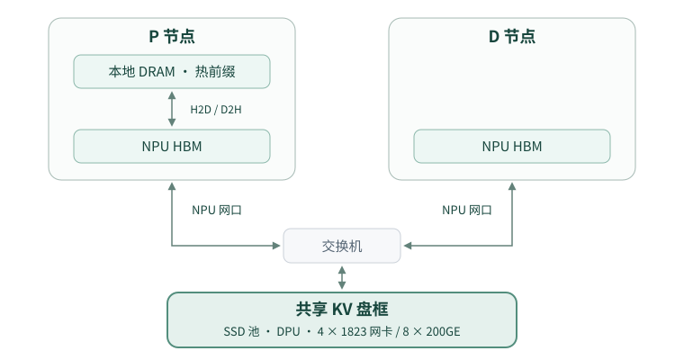

# 场景 2：共享 KV 盘框建模方案

用 SWE-chat 回放比较场景 1 的本地 DRAM＋SSD 与场景 2 的共享 KV 盘框。重点看 P 侧 DRAM 缩容后，多少 KV 读取转移到盘框，盘框带宽与同轮交接对 SLA 有什么影响，以及 D 写回的生成 KV 能否被下一轮 P 复用。

## 1. 原型拓扑与仿真范围

原型采用 **KV 语义直通**。盘框侧包含 SSD 池、DPU 和 4 个 1823 网卡，共 8 个 200GE 端口。P、D 的 NPU 网口接入交换机，KV 数据在盘框和 NPU HBM 之间搬运，绕过计算节点 CPU 和 Host DRAM。仿真将 DPU、网口和交换机合并为盘框直通路径的有效带宽与时延。

- **同轮交接**走 P HBM → 共享盘框 → D HBM。原型取消 P→D P2P 通道。
- **P 侧前缀恢复**可走本地 DRAM → HBM 或共享盘框 → HBM。两路可以同时提交不同块。
- **仿真计算配置**沿用 GLM-5.2-FP8、H200 SXM、1P1D、P/D 各 TP8。P 侧 HBM KV 固定为 2,048 块，每块 64 token，D 侧沿用既有容量。计算耗时沿用 H200，盘框链路参数单独配置。

## 2. KV 的存放、恢复与写回

### 2.1 共享盘框与本地 DRAM

共享盘框接收 P 输入和 D 输出中已计算完成的完整 KV 块，包括 P 本地 DRAM 已有副本的热块。盘框容量不足时按块级 LRU 淘汰。这里的「全量」指所有符合写回条件的完整块都进入盘框的写回流程，实际可复用范围取决于写入是否完成及块是否仍驻留。

P 本地 DRAM 保留近期复用的前缀块。同一块按实际使用它的不同 P 请求计数，同一请求的重试和分块调度合计一次，HBM 命中也计入。第二个不同请求使用该块时，若块已在 HBM 且本地 DRAM 尚无副本，可异步提交 D2H 晋升。已驻留块再次被使用时刷新 LRU。两层各自管理副本和淘汰。

### 2.2 P 侧前缀恢复

按 HBM、本地 DRAM、盘框确定可复用前缀中各块的来源，同一块只从选定层恢复。HBM 命中直接使用。本地 DRAM 和盘框可并行恢复不同块，本轮计算所需的块就绪后再执行。盘框命中的热块先直达 HBM，再按晋升规则异步复制到本地 DRAM，晋升字节单独计入 D2H。

### 2.3 同轮 P→盘框→D 交接

1. **第一阶段，提前通知与预读。** P 收到请求并确定交接清单后，异步通知 D。清单包含请求 ID、块标识、顺序和有效长度。D 在 HBM 预算允许时，将盘框中已可读的块直读到对应的 HBM 位置，同时 P 执行 Prefill。预读须计入 D 的 HBM 占用和盘框带宽。无法预读的块留到第二阶段。
2. **第二阶段，整批就绪与补读。** P 将盘框缺失的 KV 写入盘框，输入末尾不足一块时用请求私有的临时尾块交接。P 完成本轮交接准备且所需块均可读后，再通知 D。D 补读尚未加载的块，等待仍在途的预读完成，所需 KV 全部就绪后才开始 Decode。
3. **资源释放。** 盘框块在被交接引用且尚未读完时受保护。请求取消时停止后续提交，并在在途传输安全结束后释放相关保护和 HBM 预留。

后续增加「整批就绪后才开始读」作为对照，使用相同的请求、容量和链路配置，比较 TTFT、P 计算与 D 读回的重叠时间，以及 D 侧 HBM 峰值。

同一块的在途写入合并。同轮交接的 P 写入和 D 读回优先于 D 的后台写回。容量暂时不足时，交接等待并单独记录等待时间。**建议的容量边界**是整批预留，在提交前确认已有块可固定且缺失块和临时尾块均有空间，避免多个请求各占一部分后互相等待。单次交接超过盘框可用容量时应报错。

### 2.4 D 生成块写回与跨轮复用

D 参考 `simple_cpu_v0_32`。每当一个块的 64 个位置都已算出 KV，就在该请求下一次 Decode 调度时异步提交到盘框。若请求先结束，在结束处理中补交已算齐但尚未提交的完整块。刚采样的最后一个 token 可能还没有自己的 KV，未算齐的尾块暂不写回。写完成后才对其他节点可见。

下一轮 P 要复用这些块，D 与 P 必须用相同的块边界、前缀父链和哈希规则生成标识，且 KV 布局兼容。例如第一轮输入 112 个 token，D 又为 16 个输出位置算出 KV，则第 2 个 64-token 块包含 48 个输入位置和 16 个输出位置。若下一轮输入的前 128 个 token 恰好一致，这个块应得到相同标识。

SWE-chat 的验证分三步。先核对上一轮输入加已计算输出，与下一轮重建输入的共同前缀。再核对 16-token trace 哈希到 64-token 引擎块标识的映射，逐块比对 D 基于输出 token ID 生成的标识。最后清掉 P 侧 HBM 和 DRAM 副本，验证下一轮 P 确实从盘框读回 D 写入的块。真实会话分别统计内容匹配、标识一致和实际命中的块数，实际命中还受写入完成时间、淘汰和回放顺序影响。

## 3. 容量、带宽与时延

| 资源 | 参数与建模方式 |
|---|---|
| 盘框容量 | 24 × 6.984 TB = 167.616 TB 原始容量。按实际可分配 KV 容量折算块数，P、D 共用一个容量账本。 |
| 盘框直通路径 | 盘侧名义带宽 24 × 8 GB/s = 192 GB/s。8 个 200GE 端口的单方向标称合计为 200 GB/s。首版采用可配置的 160 GB/s 整框有效带宽，由 P、D 共享，并分别记录读写。 |
| P 本地 DRAM | 物理容量 384 GB、名义带宽 614 GB/s。G2 容量按扣除系统和运行时占用后的预算配置，实验扫描 128／256／384 GB 名义档位，报告实际分配块数和容量。盘框直通无需预留 Host DRAM 中转。 |
| 本地 DRAM ↔ HBM | H2D 沿用 25 GB/s／TP 分片，TP8 名义合计 200 GB/s。D2H 晋升单独计流量。两路在 NPU 侧若共享传输资源，在相应资源上计入争用。 |

**正式性能实验前待确认**。160 GB/s 是读写合计还是单方向有效值，P、D 单节点能达到的吞吐，固定 I/O 时延，以及不同请求粒度、队列深度和读写混合下的有效吞吐。首版用有效带宽、固定时延和排队建模。同轮交接的 P 写入与 D 读回分别计费。

## 4. AISim 改造范围

| 模块 | 复用与改造 |
|---|---|
| 盘框存储层 | 复用 G3 的容量、块索引、异步 I/O、计数和共享池抽象。为 P、D 绑定同一个远端池，增加整框带宽共享、写后可见、在途去重和交接保护。 |
| 连接器与调度 | 复用现有请求状态流转和恢复重试。增加盘框↔HBM 直通、本地 G2 晋升、D 提前预读、整批就绪后补读及取消释放。D 侧复用 eager 写回时机，补生成块写入盘框的路径。 |
| KV 身份与回放 | 复用 SWE 的输入哈希、输出 token ID 和现有时间轴。统一 P 输入块与 D 生成块的标识，验证布局兼容性。若后续要模拟会话内调用依赖，另设因果回放对照。 |
| 观测 | 按 P/D 与读写分别记录盘框字节数、累计流量和分窗峰值，区分容量等待、I/O 排队与传输耗时。记录同轮交接耗时、跨轮 D→P 命中、本地 DRAM 驻留与晋升流量、两路恢复重叠、重试和回退重算。 |

代码入口可从 `crates/core/src/engine/g3_offload/tier.rs`、`crates/core/src/engine/config.rs`、`crates/core/src/engine/scheduler/vllm/host_offload.rs` 和 `experiments/disk_swe/scripts/prepare_swe_chat.py` 开始核对。

## 5. 引擎改造步骤

| 步骤 | 改造内容 | 验证通过条件 |
|---|---|---|
| **1. 建立共享盘框和直通 I/O** | 复用 G3 的块索引、LRU 和异步 I/O，为 P、D 接入同一个盘框池。增加 HBM 直读、直写、写后可见和在途写入合并，统一计入整框带宽预算。 | 小样本验证写完才可读、读回绕过 DRAM、P/D 并发共享带宽，以及读写字节与块数一致。 |
| **2. 接入两阶段 P→D 交接** | 接入交接清单和两次通知。D 在 HBM 预算内预读已有块，P 完成 Prefill 并写完缺失块后，D 补读。处理整批容量预留、临时尾块、交接保护及取消释放。 | D 的预读与 P 的 Prefill 有重叠，补读跳过已加载或在途的块，全部 KV 就绪后才开始 Decode。覆盖 HBM 不足跳过预读、容量等待和取消释放。 |
| **3. 接入 P 侧分层恢复与热块晋升** | P 从本地 DRAM 和盘框并行恢复不同的前缀块。按不同 P 请求累计使用次数，第二次使用时异步晋升到本地 DRAM，单独记录 D2H 流量。 | 构造 HBM、DRAM、盘框混合命中的请求，核对逐块来源、晋升时机、流量和后续 DRAM 命中。 |
| **4. 接入 D 生成块写回与跨轮复用** | D 在下一次 Decode 调度时提交已算齐的完整块，结束时补交。统一 P/D 块标识，接入 SWE-chat 的输出 token ID 并验证真实会话。 | 两轮样本中，清掉 P 本地副本后仍能从盘框命中 D 写完的块。再抽样核对真实会话的共同前缀和块标识，记录跨轮命中与额外写流量。 |

每一步用小样本验证后再进入下一步。步骤 2 完成后即可运行首个端到端 1P1D 样本。整批就绪后才开始读的模式留作后续对照。

## 6. 验收与实验对照

1. **同轮交接小样本。** 验证 D 能在 P Prefill 期间预读盘框已有块，收到整批就绪通知后只补读未加载且不在途的块，并在全部所需 KV 就绪后开始 Decode。覆盖 D 的 HBM 预算不足时跳过预读。覆盖临时尾块、写入合并、容量等待、取消释放和 P/D 同时 I/O。按实际传输的块和字节核对流量，确认盘框读回绕过 DRAM。
2. **分层恢复与跨轮写回。** 验证 P 本地 G2 和盘框可以并行恢复不同块，第二次使用才晋升。构造两轮请求验证 D→盘框→P，覆盖前缀变化、写入未完成及未算齐尾块，再抽样真实 SWE-chat 会话。
3. **场景 1 与场景 2 对照。** 优先跑 SWE 64×，扫描 P DRAM 三档，固定请求、计算配置和 HBM 容量。先对齐聚合存储带宽，再比较本地八盘名义 64 GB/s 与盘框有效 160 GB/s 的配置。用 128× 检查高负载尾延迟。同带宽对照仍包含交接路径与缓存布局的变化，结果按整套方案解释。
4. **量化 D 生成 KV 的贡献。** 在相同盘框配置下，对比仅写入输入块与同时写入 D 生成块，报告跨轮命中收益、额外写流量和盘框占用。

性能对照沿用 SWE 联合 SLA（TTFT ≤ 1 s、TPOT ≤ 30 ms），同时报告 P99 TTFT、TPOT、盘框与 DRAM 的流量和峰值带宽。**待定验收阈值**为场景 2 相对场景 1 可接受的联合 SLA 达标率差和 P99 TTFT 差，用于判断哪档 DRAM 容量满足同一性能目标。
