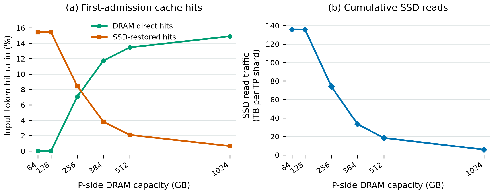
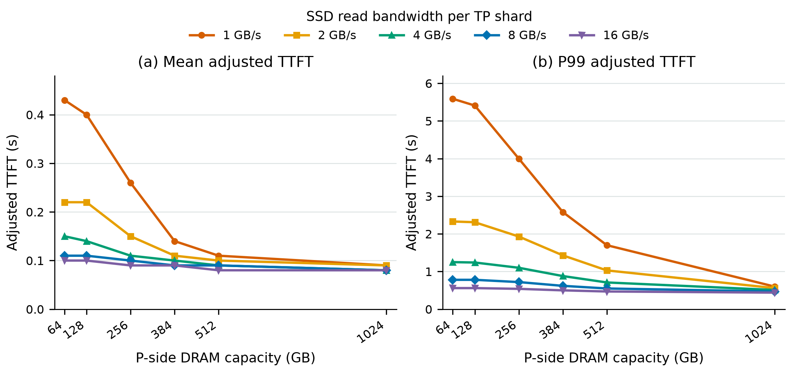

## 5. 仿真实验评估

为了评估本地 DRAM 容量与 SSD 加载带宽对系统推理性能的影响，我们利用 AISim 对 MiniMax-M2.5 的 Prefill–Decode 分离部署进行仿真，分析 DRAM 缩容引起的分层 KV 命中变化，以及不同 SSD 加载带宽对缩容后推理性能的影响，重点关注 TTFT 的变化。

### 5.1 仿真方法与实验设置

#### 5.1.1 推理仿真平台

实验基于 AISimulate 0.14.0 构建离线推理仿真平台，并对其进行改进，以满足本研究的仿真与统计需求[1]。仿真采用算子级性能模型估计前向计算耗时，通过离散事件模拟请求调度、KV 恢复与 PD 交接。在 P 侧建模 HBM、DRAM 和本地 SSD 三级缓存，采用异步写入与 LRU 淘汰策略；按模型 KV 布局和精度计算块容量，并根据传输字节数、带宽及固定时延估计恢复耗时。统计时区分 DRAM 直接命中与 SSD 恢复命中，并分解 P 首次准入前的调度等待和 KV 恢复等待。

具体实验配置如下。

- 模型与部署： 采用 MiniMax-M2.5，权重与计算使用 FP8 block 精度，Attention 与 KV 使用 BF16。硬件性能参数沿用 H100 SXM，将单卡总 HBM 容量设为 64 GB，保留其计算、带宽和互联参数。采用 1P1D 部署，P/D 各配置 8 张 GPU，Attention 使用 TP8／DP1，MoE 使用 TP1／EP8，推理后端按 vLLM 0.24.0 建模。

- 缓存与传输： P 使用 HBM、DRAM 和本地 SSD，D 仅使用 HBM。HBM KV 容量在 90% 的显存预算内扣除权重等开销后自动估算，KV 块大小为 64 token。P 侧 DRAM 设置为 64、128、256、384、512 和 1024 GB，SSD 容量约为 56 TB，均通过块数近似配置。SSD 读带宽设置为 1、2、4、8 和 16 GB/s，写带宽固定为 8 GB/s，首字节时延为 0.1 ms；H2D／D2H 带宽均为 25 GB/s，P→D 直接交接带宽为 50 GB/s。带宽均按单个 TP 分片设置。

- 调度与负载： 开启 Chunked Prefill，P/D 每轮 token 预算均为 16,384，序列上限分别为 32 和 256。

#### 5.1.2 Agent Trace 数据集构建

实验负载来自 SWE-chat 数据集中的真实编程 Agent 交互日志，包含用户对话、模型响应、工具调用及工具结果等信息[2]。我们选取 Claude Code 主会话，依据请求标识与工具调用标识整理交错日志，重建每次模型调用的输入历史及输出内容，并筛选输入与输出合计不超过 128K token 的请求，最终得到 607,190 条请求，覆盖 10,962 个会话。

数据处理时，按照聊天模板组织输入内容，使用 tokenizer 对输入与输出进行分词，获得请求长度与输出 token 序列。随后，每 16 个输入 token 生成一个链式前缀哈希，用于识别不同请求之间的相同前缀块，并将请求时间戳、输入输出长度、前缀哈希及输出 token 序列导出为 Mooncake JSONL 格式。请求到达时间采用日志首个响应事件的时间戳近似，并转换为相对毫秒时间。

为构造更高负载，我们将原始时间轴划分为 32 段，各会话按照首个请求所在的时间段整体平移叠加，保留会话内部各次调用的相对间隔。跨段长会话的后续请求随会话一并平移，因此回放保留了越界尾部，整体跨度约为 33.11 天，仿真时按处理后的时间戳独立发起各请求。

### 5.2 实验结果

#### 5.2.1 DRAM 缩容使缓存命中向 SSD 转移

图 1　固定 SSD 读带宽为 8 GB/s／TP 分片时，DRAM 容量对分层命中及 SSD 读取量的影响。（a）DRAM 直接命中和 SSD 恢复命中的 token 占全部输入 token 的比例，按 P 首次准入时实际使用的命中量统计；（b）整场累计 SSD 读取量，按单个 TP 分片计量。容量按离散实验档位扫描。

如图 1 所示，随着 DRAM 容量减小，前缀 KV 的命中层级逐步由 DRAM 转向 SSD。DRAM 从 1024 GB 降至 256 GB 时，DRAM 直接命中占比由 14.908% 降至 7.074%，SSD 恢复命中占比由 0.653% 升至 8.427%；进一步降至 128 GB 时，DRAM 直接命中占比接近零，SSD 恢复命中占比升至 15.451%。在此过程中，总前缀命中占比保持在约 97.65%，表明 DRAM 缩容主要改变了 KV 的获取层级，SSD 恢复补充了 DRAM 命中的减少，使整体前缀命中比例基本保持稳定。

命中层级的转移显著增加了 SSD 读取流量。DRAM 从 512 GB 缩至 128 GB 时，累计 SSD 读取量由 18.396 TB 增至 135.721 TB，达到原来的 7.38 倍。当 DRAM 容量降至 128 GB 及以下时，DRAM 直接命中占比已接近零，SSD 恢复命中占比与累计读取量逐渐趋于稳定，下级缓存命中主要由 SSD 承担。

#### 5.2.2 DRAM 越小，对 SSD 加载带宽越敏感

图 2　不同 SSD 读带宽下，扣排队后 TTFT 对 DRAM 容量的敏感性。（a）均值；（b）P99。每条曲线对应一个 SSD 有效读带宽档位，单位为 GB/s／TP 分片；其他参数保持一致。扣排队后 TTFT 仅扣除 P 首次准入前的调度等待；均值和 P99 由逐请求调整后的数值统计。

如图 2 所示，DRAM 缩容对 TTFT 的影响随 SSD 读带宽增大而减弱。当读带宽为 1 GB/s／TP 分片时，DRAM 从 512 GB 降至 64 GB，扣排队后平均 TTFT 由 0.11 s 增至 0.43 s，P99 由 1.70 s 增至 5.59 s，尾时延增加 3.89 s。读带宽提高至 8 GB/s／TP 分片后，相同容量变化对应的平均 TTFT 仅由 0.09 s 增至 0.11 s，P99 由 0.55 s 增至 0.78 s，尾时延增量缩小至 0.23 s；在 16 GB/s／TP 分片下，P99 差距进一步缩小至 0.09 s。这表明，较高的 SSD 加载带宽能够减轻系统推理性能对 DRAM 容量变化的敏感性。

对于 64 GB DRAM 配置，将 SSD 读带宽从 1 提高至 8 GB/s／TP 分片，可使扣排队后 P99 TTFT 从 5.59 s 降至 0.78 s，降低约 86.0%。结合图 1 可见，DRAM 缩容后，总前缀命中比例基本稳定，但更多 KV 需要从 SSD 恢复，增加了存储读取需求。因此，在本实验范围内，低 DRAM 容量配置需要更高的 SSD 有效加载带宽，以维持相近的推理性能。

参考文献

[1] AI-DYNAMO. AISim[CP/OL]. [2026-11-23]. https://github.com/ai-dynamo/aisim.

[2] BAUMANN J, PADMAKUMAR V, LI X, et al. SWE-chat: Coding Agent Interactions From Real Users in the Wild[EB/OL]. (2026-04-22)[2026-11-23]. https://arxiv.org/abs/2604.20779. DOI:10.48550/arXiv.2604.20779.
