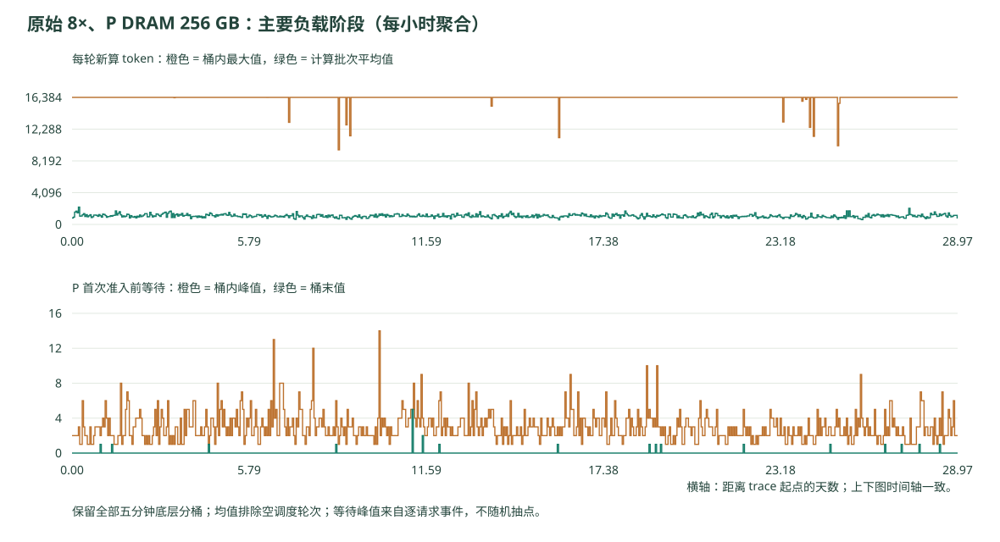
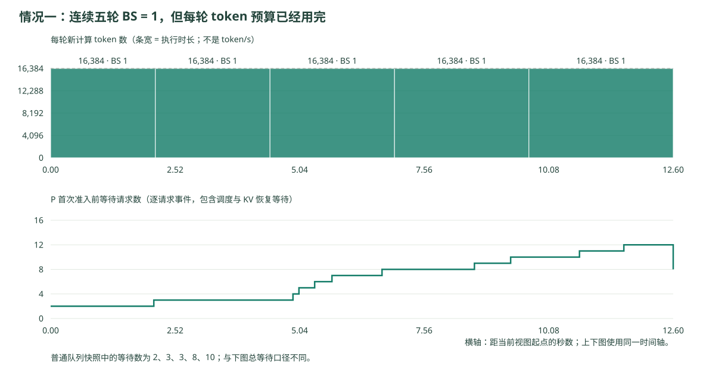
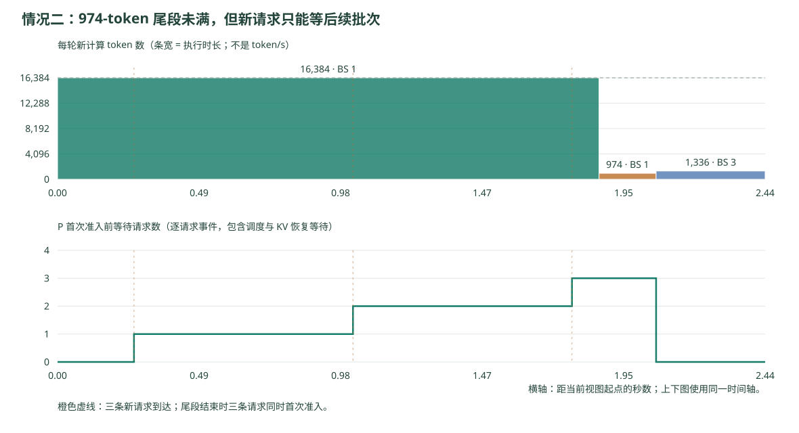

# 原始 8× 下的 Prefill 排队：两个具体案例

本记录解释两种现象：BS 未满但单轮 token 预算已满；以及单轮 token 预算也未满，但异步调度已提交的批次不再接收新到请求。两种现象均来自已有实验的原始记录，没有重跑或修改引擎。

交互图表见 [独立 HTML](prefill_queue_diagnosis.html)。HTML 内嵌数据，可单文件离线打开；本文的 SVG 图片位于 analysis/prefill_queue_diagnosis，转发 Markdown 时需一并保留。

## 1. 实验与图表口径

- 原始 8× 会话叠加包，时间压缩系数 **1**，不是再压缩 8 倍的实验。
- GLM-5.2-FP8、H200 SXM、1P1D、各 TP8／EP8；P DRAM 256 GB，SSD 读 2 GB/s／TP 分片、写 8 GB/s／TP 分片；D 仅 HBM。
- P 单轮预算 16,384 token，序列上限 32，HBM KV 容量 6,103 块，块大小 64 token。
- 原五分钟窗口：第 7.9027778–7.9062500 天，对应仿真时间 682,800.000–683,100.000 秒。为画完情况一的第五批，数据范围延长至 683,100.434 秒；不将延长段计入原五分钟汇总。
- 图一：每批次新计算 token 数。横向宽度为真实计算时长，纵向高度为该批次新算 token 数；不是 token/s，面积也不表示累计 token。横虚线为整批 16,384-token 预算。
- 图二：P 首次准入前等待请求数，按逐请求到达与首次准入事件计算，包含调度与 KV 恢复等待；不等于 PD 全部未完成请求数。
- 表格中的“普通队列等待”取调度后状态快照，排除了连接器等待等状态，与图二口径不同。同一时刻的到达和准入事件合并处理，不制造零时长积压。

## 2. 主要负载阶段全程图

主要负载阶段为前 **28.974 天**。默认每小时展示一个聚合桶；HTML 可切换每 15 分钟或每 5 分钟，保留全部 8,345 个底层五分钟桶，不使用随机抽点。

| 统计项 | 主要负载阶段 |
|---|---:|
| 实际计算批次数 | 600,464 |
| 实际新算 token 总量（按批次计算开始归属） | 645,369,686 |
| 用满 16,384-token 预算的批次占比 | 0.92% |
| P 首次准入前等待峰值 | 14 条 |

全程上图展示桶内**每轮新算 token 最大值与平均值**；均值由总新算 token 数除以真实计算批次数得到，合并时间桶时按批次数加权，排除无计算的调度轮次。桶内没有计算时留空，不画为 0-token 计算。这里的横向宽度表示聚合桶长度，不再表示单批执行时长；单批耗时请看后面的秒级案例。

全程下图展示**桶内等待峰值和桶末等待数**。峰值根据所有逐请求到达、首次准入事件计算，不会因为低频抽样漏掉短时积压。桶末取结束前一瞬，最后一个不足整桶的时间段按实际长度处理。

这两个全程图适合发现哪些时段频繁出现满预算批次、哪些时段有突发等待。它们不能证明两个桶内峰值发生在同一瞬间，更不能据此认定每次等待都由 token 预算造成。全程图与秒级案例互补使用。

HTML 的“选择观察窗口”还可切换到“五分钟中心 ±1 小时”：以原五分钟的中点为中心，左右各一小时，总共两小时。横轴改用相对中心的分钟数，绿色背景标记原五分钟。该视图使用实际逐轮计算与逐请求等待事件，不做随机抽样；提取数据见 [extended_window_data.json](analysis/prefill_queue_diagnosis/extended_window_data.json)。

## 3. 情况一：BS 为 1，但整批 token 预算已满

观察区间：仿真时间 683,087.835–683,100.434 秒，持续约 12.599 秒。上下图共用时间轴，便于直接对齐等待出现和每轮执行的关系。

| 轮次 | 实际 BS／上限 | 新算 token／预算 | 调度后普通队列等待 | 本轮耗时（秒） |
|---|---:|---:|---:|---:|
| 1 | 1／32 | 16,384／16,384 | 2 | 2.119 |
| 2 | 1／32 | 16,384／16,384 | 3 | 2.320 |
| 3 | 1／32 | 16,384／16,384 | 3 | 2.520 |
| 4 | 1／32 | 16,384／16,384 | 8 | 2.720 |
| 5 | 1／32 | 16,384／16,384 | 10 | 2.920 |

16,384 是**整个批次**的 token 预算，不是每个请求各有一份。当前调度器先安排已经运行的请求，一个长请求可以独自耗尽整轮预算。Chunked Prefill 允许长输入分轮计算，但不保证每轮把预算分给多个请求；因此 BS 未达 32，也不能继续向本轮加入需要计算的新请求。

一条输入为 102,948 token 的请求在这段连续计算中到达，首次准入前 KV 等待为 0，调度等待约 **10.511 秒**。这是本案例中 token 预算和调度顺序影响响应的直接例子，不能由此认定 GPU 算力利用率已达到 100%。

## 4. 情况二：974-token 尾段未满，但批次已提前提交

原请求输入 17,486 token，复用 128 token，新计算量正好是：

`17,486 − 128 = 16,384 + 974`。

| 批次 | 新算 token | BS | 本轮耗时（秒） |
|---|---:|---:|---:|
| 原请求主要 chunk | 16,384 | 1 | 1.869 |
| 原请求剩余尾段 | 974 | 1 | 0.197 |
| 三条新请求 | 1,336 | 3 | 0.376 |

以下时刻均以主要 chunk 开始为 0；三条请求在第一批执行期间陆续到达，尾段结束后在同一时刻首次准入，KV 恢复等待均为 0。

| 新请求 | 输入 token | 到达（秒） | 首次准入（秒） | 调度等待（秒） |
|---|---:|---:|---:|---:|
| 1 | 117,009 | 0.264 | 2.066 | 1.802 |
| 2 | 9,291 | 1.020 | 2.066 | 1.046 |
| 3 | 41,180 | 1.776 | 2.066 | 0.290 |

尾段执行时，BS 为 1／32，新算量为 974／16,384，活跃 HBM 块为 274／6,103，SSD 待读、H2D 加载任务均为 0。这轮无法继续合批的解释是当前 AISim 的异步调度准入规则，而不是本轮 token 或 HBM 容量耗尽。

当前 vLLM 后端默认异步批次深度为 2：忙碌时将下一批视为已提交。到达时已经提交的批次不能再被该请求修改；等待队列使用 admissible_from_pass 检查允许准入的轮次。该例三条请求被推迟到尾段之后，额外延后约 **197 ms**。这些规则来自 AISim 当前实现，尚未通过实机验证其与对应 vLLM 版本是否完全一致。

## 5. 如何理解低平均忙碌占比与排队

原五分钟窗口 P 计算约 49.37 秒，忙碌占比约 16.46%；普通准入队列非空约 12.36 秒，按状态快照还原，这些普通队列等待时段与 P 计算重叠。五分钟平均值混合了长时间空闲与短时间连续计算，不能据此判断某条请求到达时是否能够立即执行。

上述两例说明：**序列数上限、单轮 token 预算和异步批次准入时机是不同约束。** 它们可以使有潜在硬件余量的系统仍产生等待。它们不能量化 GPU 算力利用率，也不能解释全部长尾 TTFT；是否应调整预算或异步调度，需要单因素对照实验。

## 6. 复核与生成

- 源结果目录：`/home/xieqiang/project/results/swe-chat-glm52-throughput-capacity/20261119T075854.538229Z/cases/swe_h200_ep8_capacity_p256gb_speed1/runs/20261119T075907.105935Z/prediction`。
- 计算批次：iteration_metrics.jsonl.gz，使用 compute_start_ms、end_ms、prefill_bs、prefill_new_tokens；无计算批次不画成工作条。
- 调度状态：scheduler_states.jsonl.gz，边界为调度后、发出执行前。
- 等待曲线：requests.jsonl，`Q(t) = count(arrival_time_ms ≤ t < prefill_admit_ms)`。
- 提取数据：[window_data.json](analysis/prefill_queue_diagnosis/window_data.json)。保留的是选定窗口数据，不是全量请求副本。
- 生成入口：[build_prefill_queue_diagnosis.py](scripts/build_prefill_queue_diagnosis.py)；页面模板：[prefill_queue_dashboard.html](scripts/prefill_queue_dashboard.html)。在仓库根目录执行 `~/.venvs/aisim/bin/python experiments/disk_swe/scripts/build_prefill_queue_diagnosis.py` 可重新生成 MD、HTML、SVG。
- 调度源码：[准入轮次与等待队列](../../crates/core/src/engine/scheduler/vllm/core.rs)；[异步批次深度默认解析](../../crates/core/src/engine/config.rs)。

## 7. 128 GB 对照与延迟联动

HTML 新增 P DRAM 128／256 GB 配置选择，其余保持原始 8×、speedup=1、SSD 读 2 GB/s/TP、16,384-token 预算。两组共用同一主要时段和局部窗口。原两种秒级案例的解释只对应 256 GB 配置。

主要阶段按请求到达时间分桶，以请求数加权显示原始 TTFT、扣排队后 TTFT 和两者差额的均值；局部图每个点为一个请求，横轴是到达时刻，点的延迟包含其后直至首 token 的等待与执行。三幅图共用时间轴和游标。差额等于报告的首次准入前调度等待，是定义关系，不是独立的因果验证；扣排队后 TTFT 仍含 KV 恢复、后续 chunk 和 D 侧等时间。

相关性以主要阶段每个请求到达前的 P 等待数与其延迟配对，输出 Pearson 与 Spearman 系数；不以相关性证明算力饱和或排队是唯一成因。

### P DRAM 256 GB

| 延迟项 | Pearson | Spearman |
|---|---:|---:|
| 原始 TTFT | 0.2330 | 0.0874 |
| 扣排队后 TTFT | 0.0970 | 0.0629 |
| 被扣除的调度等待 | 0.3428 | 0.1751 |

### P DRAM 128 GB

| 延迟项 | Pearson | Spearman |
|---|---:|---:|
| 原始 TTFT | 0.5210 | 0.0875 |
| 扣排队后 TTFT | 0.1773 | 0.0678 |
| 被扣除的调度等待 | 0.6512 | 0.1611 |
